# IMS — Inventory Management System

[](https://github.com/nminhcuongdev/IMS_solutions/actions/workflows/ci.yml)

A warehouse and light-manufacturing inventory system: a web back office, a REST API and two Android handheld apps
(barcode/QR scanner and UHF RFID reader). It follows goods end to end — receiving, put-away, picking, shipping,
returns, holds, disposal, location transfer, production (material picking, consumption, output, labels) and
stocktaking — and can trace any lot backward to its suppliers or forward to its customers.

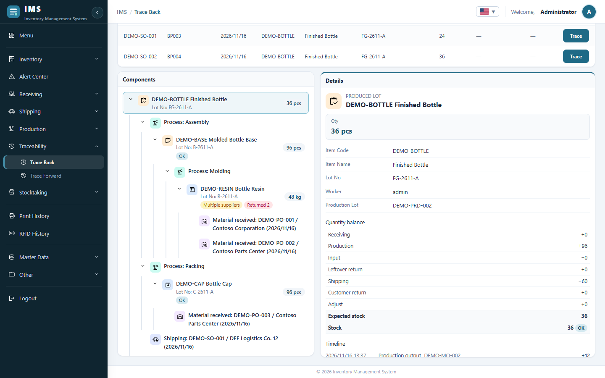

## Features

| Area | What it does |
|---|---|
| **Master data** | Factories, zones, 3-level locations (`Large_Middle_Small`), item groups, items, business partners, reasons, processes, devices, users — search, sort, paging, copy, CSV export |
| **Receiving / Returns** | Schedules (manual entry or Excel import), package-by-package confirmation on the handheld, shortage registration that closes the line, status change that posts and takes back real stock |
| **Shipping / Picking** | Schedules, picking by lot (FEFO), line confirmation, shortage handling that returns picked goods to the shelf, label reprint |
| **Production** | Production orders imported from CSV, material picking and receipt, consumption by scanned lot, leftover return, output with lot and expiry, label issue, reversal of any result with a reason |
| **Traceability** | Trace back from a finished lot to every material lot, process and supplier; trace forward from a material lot to the lots it went into and the customers they were shipped to. Per-lot quantity balance, event timeline, multiple-supplier warning, CSV export |
| **Inventory** | Stock inquiry by lot / item / location, adjust, hold & release, disposal and restore, location transfer, append-only work history |
| **Stocktaking** | Per-session snapshots (Start → Complete → Finalize), handheld counting that only accepts labels at the right shelf, missing-label write-off, history per session |
| **RFID** | Live EPC stock-count board with part targets; the RFID handheld registers new tags by part and counts per device |
| **Location 3D** | Interactive 3D racking view; location codes are read as X / Y / Z coordinates |
| **Alert center** | Expiring lots, low / overflow stock, holds, late schedules — thresholds configurable per alert type |
| **Labels** | QR / GS1 labels through a local label print engine (optional), print history with exact reprint |
| **Data distribution** | Publishes handheld app updates (APK) to targeted devices; the HT app downloads, verifies and installs them |
| **Administration** | Role master with a permission matrix per function and action, enforced on every endpoint; menu visibility; UI and error texts editable in the database (English, Japanese, Vietnamese) |

## Screenshots

| Dashboard | Stock inquiry |
|---|---|
| 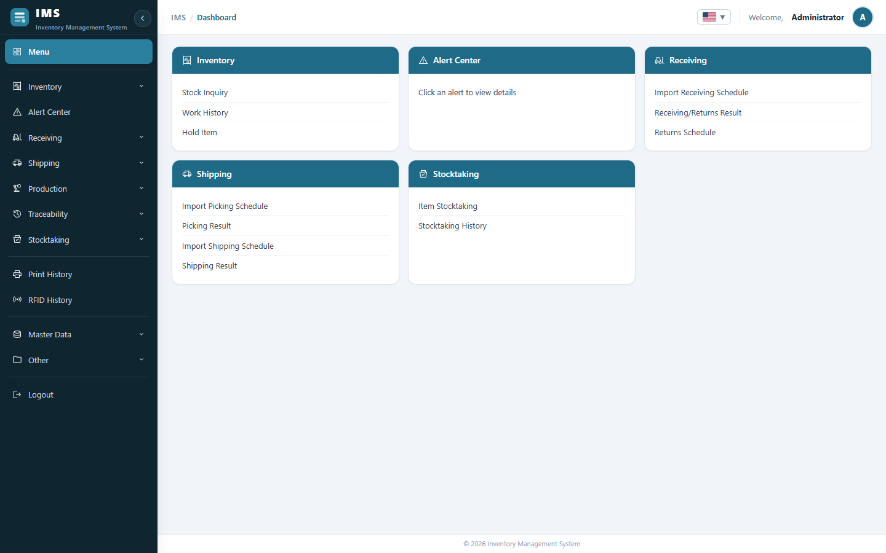 | 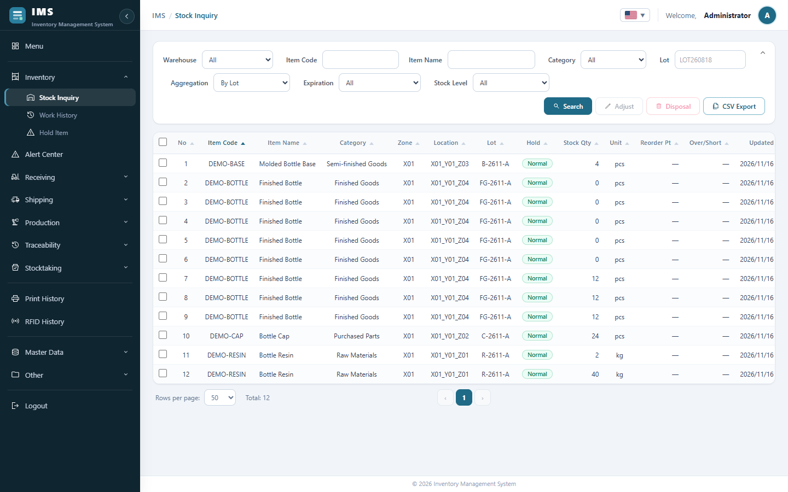 |

| Production orders | Production results |
|---|---|
| 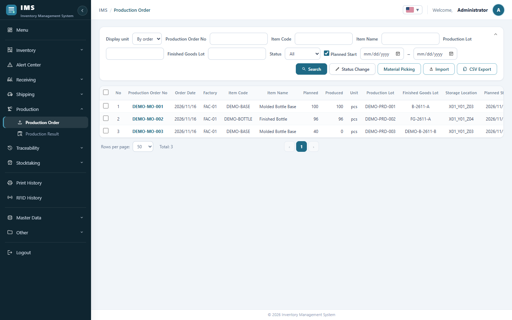 | 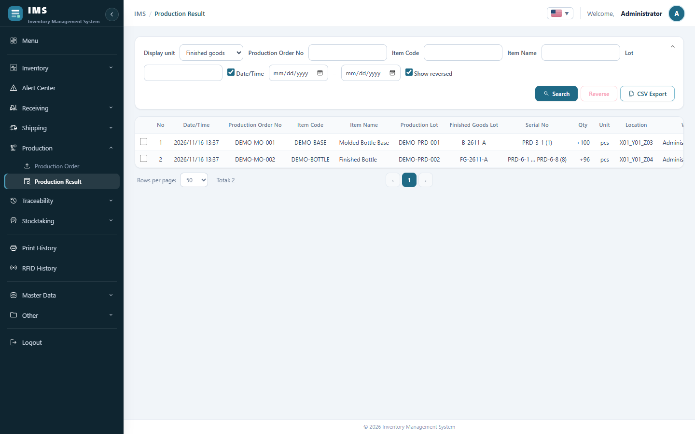 |

| Trace back | Trace forward |
|---|---|
|  | 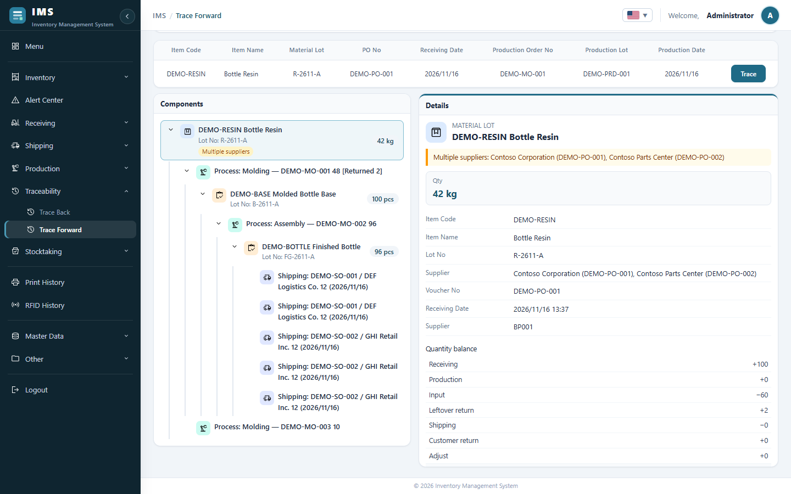 |

| Receiving schedule | Shipping result |
|---|---|
| 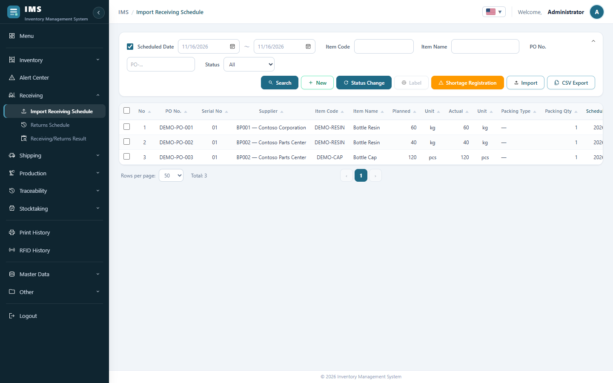 | 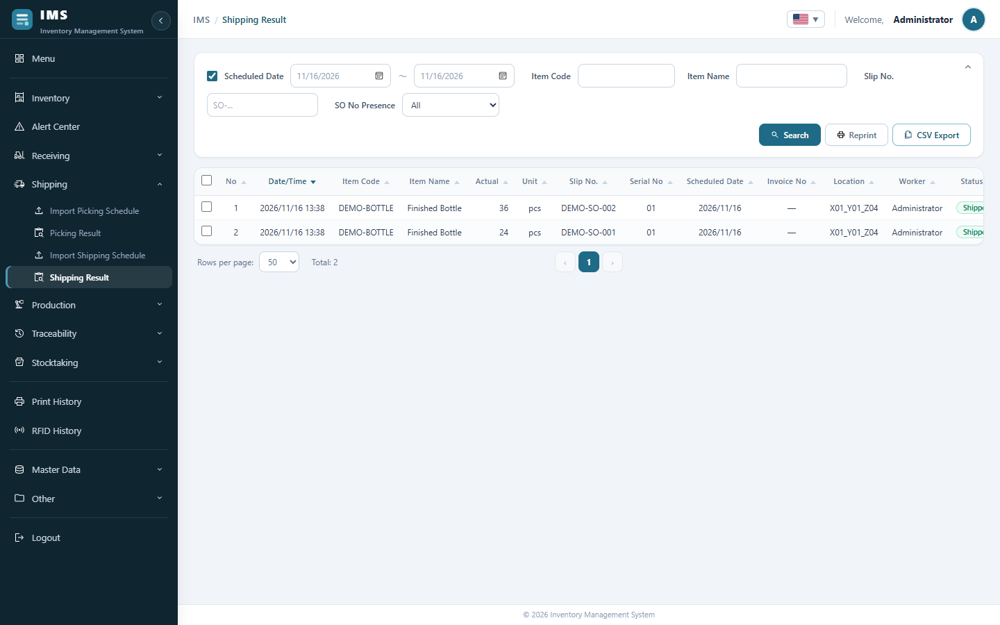 |

| Stocktaking | Alert center |
|---|---|
| 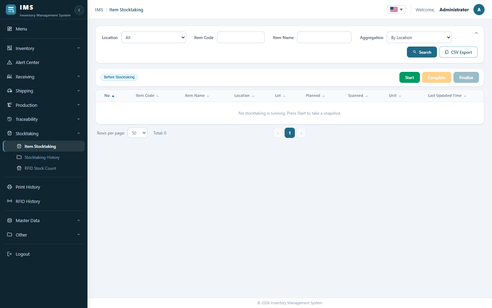 | 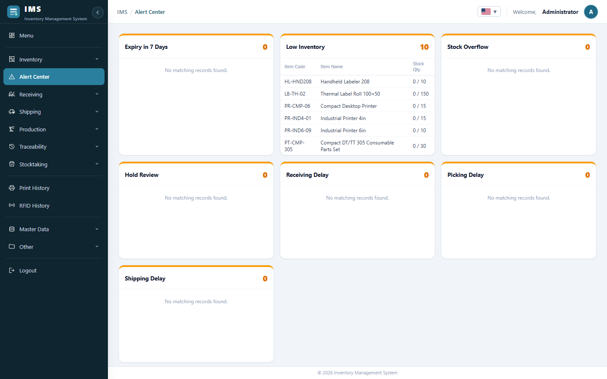 |

| User permissions | Data distribution |
|---|---|
| 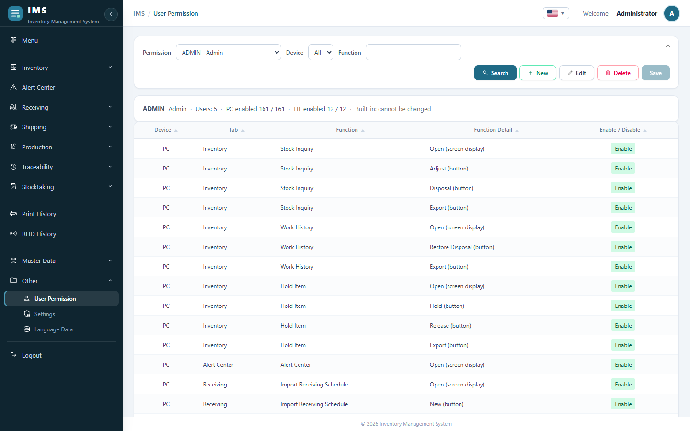 | 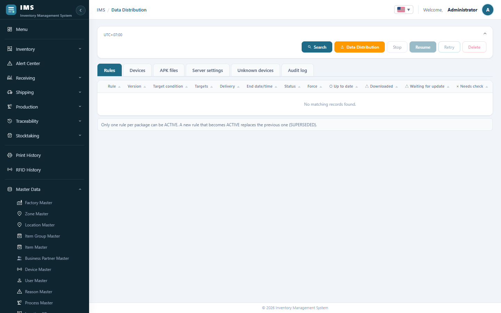 |

| RFID stock count | Location 3D |
|---|---|
| 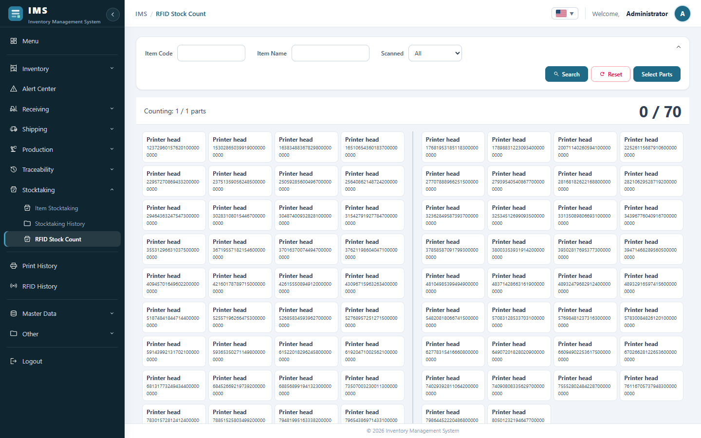 |  |

| Login | Item master |
|---|---|
| 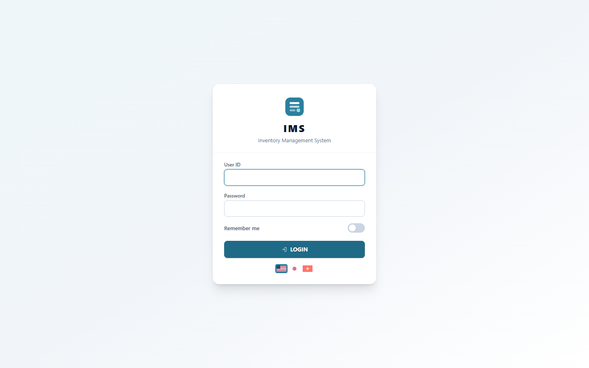 | 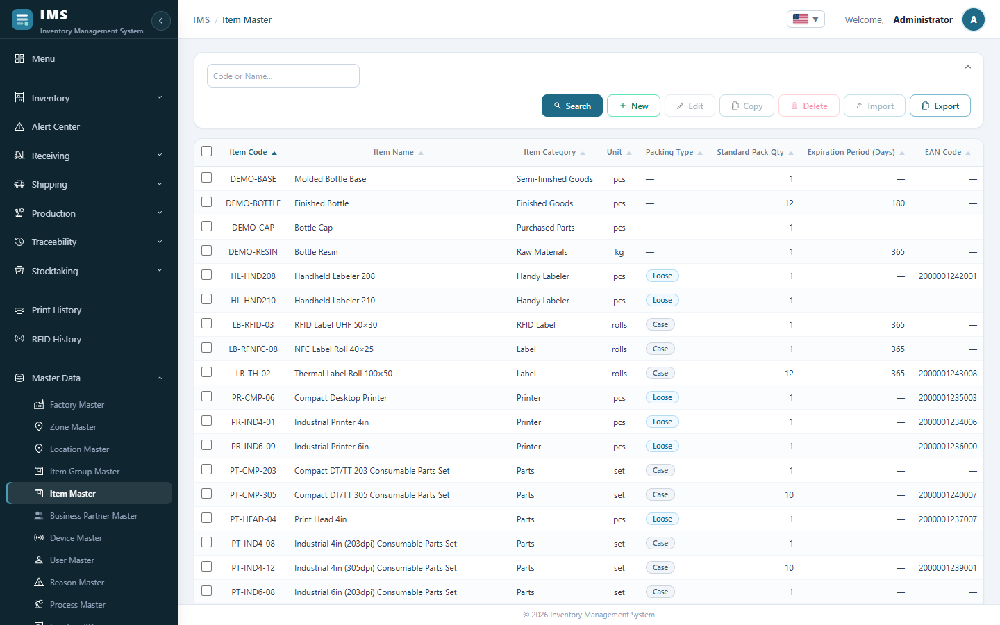 |

## Architecture

```
┌──────────────┐      ┌────────────────────┐      ┌──────────────┐
│ React SPA    │─────▶│ ASP.NET Core API   │─────▶│ SQL Server   │
│ (Vite, TS)   │ JWT  │ Minimal APIs, EF   │      │              │
└──────────────┘      └────────────────────┘      └──────────────┘
                             ▲        ▲
         ┌───────────────────┘        └──────────────────┐
┌──────────────────┐                          ┌───────────────────┐
│ Android HT app   │                          │ Android RFID app  │
│ QR / barcode     │                          │ UHF RFID readers  │
└──────────────────┘                          └───────────────────┘
```

| Folder | Stack | Details |
|---|---|---|
| [`Backend/`](Backend) | .NET 10, ASP.NET Core Minimal APIs, EF Core 10 (SQL Server), JWT, xUnit (1,400+ tests) | [Backend/README.md](Backend/README.md) |
| [`Frontend/`](Frontend) | React 18, TypeScript, Vite 5, Tailwind CSS 4, React Router 6, react-three-fiber | [Frontend/README.md](Frontend/README.md) |
| [`Android/`](Android) | Kotlin, Jetpack Compose, Retrofit — handheld scanner app | [Android/README.md](Android/README.md) |
| [`AndroidRfid/`](AndroidRfid) | Kotlin, Jetpack Compose — RFID stock count and tag registration (CipherLab RS36, DENSO SP1, Newland MT93) | [AndroidRfid/app/libs/README.md](AndroidRfid/app/libs/README.md) |

## Quick start with Docker

Requirements: Docker Desktop (or Docker Engine with Compose v2).

```bash
cp .env.example .env
```

Edit `.env` and set **your own** values:

- `MSSQL_SA_PASSWORD` — a strong SQL Server password (8+ chars, upper/lower case, digit, symbol)
- `JWT_KEY` — at least 64 random characters, for example `openssl rand -base64 64 | tr -d '\n'`

```bash
docker compose up -d --build
```

| Service | URL |
|---|---|
| Web | http://localhost:8090 |
| API | http://localhost:8091 (health check: `/health`) |
| SQL Server | `localhost,14333` |

On first start the API creates the database, applies migrations and seeds demo data.

### Demo accounts

| User ID | Password | Role |
|---|---|---|
| `admin` | `password` | Administrator |
| `superadmin` | `superadmin` | Super Admin (menu visibility, system settings) |

Change these passwords before exposing the system anywhere.

## Local development

See the README in each folder: [Backend](Backend/README.md), [Frontend](Frontend/README.md),
[Android HT app](Android/README.md). The RFID app needs the reader vendors' SDKs, which are not included in this
repository because of their licences ([AndroidRfid/app/libs/README.md](AndroidRfid/app/libs/README.md)).

## Label printing (optional)

Label printing is done by a local label print engine reached from the browser at `http://localhost:8080/` and from
the API through `MlEngine:BaseUrl`. Without it, every other feature works; print buttons report that the engine is
not available. Label layout files are not part of this repository.

## Continuous integration

[`.github/workflows/ci.yml`](.github/workflows/ci.yml) runs on every push to `main` and on pull requests:

| Job | Steps |
|---|---|
| Backend | restore, build, run the xUnit suite, upload test results |
| Frontend | `npm ci`, `tsc --noEmit`, `vite build` |
| Android HT app | unit tests and debug APK (uploaded as an artifact) |
| Docker images | builds the API and web images |

The RFID app is not built in CI because it needs the vendor SDKs.

## Project structure

```
.
├── Backend/
│   ├── src/Ims.Domain/           entities
│   ├── src/Ims.Infrastructure/   EF Core configuration, migrations, seed data, permission catalog
│   ├── src/Ims.Api/              Minimal API features, hosting, contracts
│   └── tests/Ims.Api.Tests/      xUnit tests (SQLite in memory)
├── Frontend/                     React SPA
├── Android/                      handheld scanner app
├── AndroidRfid/                  RFID stock count app
├── docs/screenshots/
├── docker-compose.yml
└── .github/workflows/ci.yml
```
