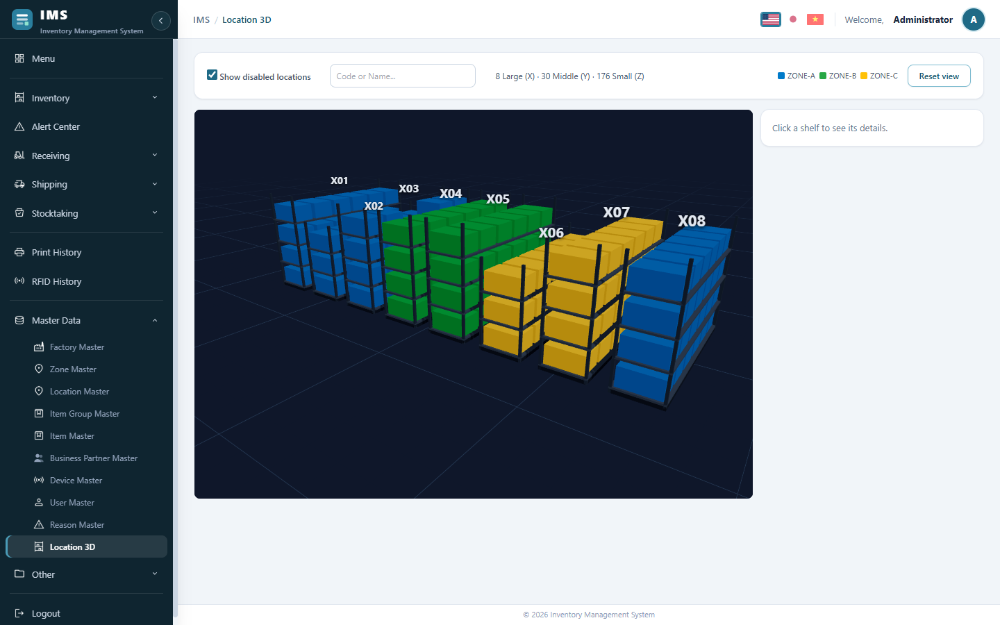

# IMS — Inventory Management System

[](https://github.com/nminhcuongdev/IMS_solutions/actions/workflows/ci.yml)

A warehouse inventory management system with a web back office, a REST API and two Android
handheld apps (barcode/QR scanner and UHF RFID reader). It covers the full flow of goods:
receiving, put-away, picking, shipping, returns, holds, disposal, location transfer, stocktaking
and RFID stock counts, plus label printing and an alert center.



## Features

| Area | What it does |
|---|---|
| **Master data** | Factories, zones, locations (3-level `Large_Middle_Small` codes), item groups, items, business partners, reasons, devices, users — with search, sort, paging, copy and CSV export |
| **Receiving / Returns** | Schedules (manual entry or Excel import), package-by-package confirmation from the handheld, shortage reasons, status change that posts and reverses real stock |
| **Shipping / Picking** | Schedules, line confirmation, shortage handling, label reprint |
| **Inventory** | Stock inquiry by lot / item / location, adjust, hold & release, disposal, location transfer, append-only work history |
| **Stocktaking** | Snapshot-based count (Start → Complete → Finalize), handheld counting, missing / over handling, history |
| **RFID stock count** | Live board of EPC tags; the RFID handheld app reads tags and posts them in batches |
| **Location 3D** | Interactive 3D view of the racking, with location codes read as X / Y / Z coordinates |
| **Alert center** | Expiring lots, low / overflow stock, holds, late receiving / picking / shipping — configurable thresholds |
| **Label printing** | QR / GS1 labels through a local label print engine (optional) |
| **Administration** | Role-based permissions per function and action, data-driven menu, UI text editable in the database (English, Japanese, Vietnamese) |

## Screenshots

| Login | Item master |
|---|---|
|  |  |

| RFID stock count | Location 3D |
|---|---|
|  |  |

## Architecture

```
┌──────────────┐      ┌────────────────────┐      ┌──────────────┐
│ React SPA    │─────▶│ ASP.NET Core API   │─────▶│ SQL Server   │
│ (Vite, TS)   │ JWT  │ Minimal APIs, EF   │      │              │
└──────────────┘      └────────────────────┘      └──────────────┘
                             ▲        ▲
         ┌───────────────────┘        └──────────────────┐
┌──────────────────┐                          ┌───────────────────┐
│ Android HT app   │                          │ Android RFID app  │
│ QR / barcode     │                          │ UHF RFID readers  │
└──────────────────┘                          └───────────────────┘
```

| Folder | Stack |
|---|---|
| [`Backend/`](Backend) | .NET 10, ASP.NET Core Minimal APIs, EF Core 10 (SQL Server), JWT auth, xUnit (730+ tests on in-memory SQLite) |
| [`Frontend/`](Frontend) | React 18, TypeScript, Vite 5, Tailwind CSS 4, React Router 6, react-three-fiber |
| [`Android/`](Android) | Kotlin, Jetpack Compose, Retrofit — handheld terminal app for scanning workflows |
| [`AndroidRfid/`](AndroidRfid) | Kotlin, Jetpack Compose — RFID stock count app (CipherLab RS36 and DENSO SP1 readers) |

The backend follows a feature-folder layout: each feature has its endpoints (thin HTTP adapters),
a service interface, an `internal sealed` service holding validation and queries, and one DTO per
file. Every response uses a common envelope (`ApiSuccess`, `ApiListSuccess` with paging,
`ApiError` with an error code). Data is soft-deleted and natural business codes are primary keys.

## Quick start with Docker

Requirements: Docker Desktop (or Docker Engine with Compose v2).

```bash
cp .env.example .env
```

Edit `.env` and set **your own** values:

- `MSSQL_SA_PASSWORD` — a strong SQL Server password (8+ chars, upper/lower case, digit, symbol)
- `JWT_KEY` — at least 64 random characters, for example `openssl rand -base64 64 | tr -d '\n'`

```bash
docker compose up -d --build
```

| Service | URL |
|---|---|
| Web | http://localhost:8090 |
| API | http://localhost:8091 (health check: `/health`) |
| SQL Server | `localhost,14333` |

On first start the API creates the database, applies migrations and seeds demo data.

### Demo accounts

| User ID | Password | Role |
|---|---|---|
| `admin` | `password` | Administrator |
| `superadmin` | `superadmin` | Super Admin (menu visibility, system settings) |

Change these passwords before exposing the system anywhere.

## Local development

### Backend

Requirements: .NET 10 SDK and SQL Server (Express or Developer).

```bash
cd Backend
dotnet build
dotnet test tests/Ims.Api.Tests
dotnet run --project src/Ims.Api
```

The API listens on `http://localhost:5271`. In Development it migrates and seeds the database
named in `ConnectionStrings:Ims` (default `localhost\SQLEXPRESS`, database `Ims`). Override it
with an environment variable or user secrets, e.g. `ConnectionStrings__Ims="Server=...;"`.

In Production the API refuses to start unless `Jwt:Key` is set to a non-placeholder value of 64+
characters. Provide it through the `Jwt__Key` environment variable or an
`appsettings.Secrets.json` file next to the binaries (ignored by git).

Migrations:

```bash
dotnet ef migrations add <Name> --project src/Ims.Infrastructure --startup-project src/Ims.Api
dotnet ef database update --project src/Ims.Infrastructure --startup-project src/Ims.Api
```

### Frontend

Requirements: Node.js 22.

```bash
cd Frontend
npm ci
npm run dev            # http://localhost:5173, talks to http://localhost:5271
npx tsc --noEmit       # type check
npx vite build         # production bundle in dist/
```

The API address comes from `VITE_API_BASE`. When it is empty, the app calls the same host it was
opened from on port `VITE_API_PORT` (default `8091`), so other machines on the LAN work without
rebuilding.

### Android HT app

Requirements: Android Studio (or JDK 17 + Android SDK 35).

```bash
cd Android
./gradlew assembleDebug testDebugUnitTest
```

Set the server URL on the login screen. For a device on USB, `adb reverse tcp:8091 tcp:8091`
lets it reach an API running on your PC.

### Android RFID app

The reader vendors' SDKs are **not included** in this repository because of their licences.
See [`AndroidRfid/app/libs/README.md`](AndroidRfid/app/libs/README.md) for the files to add, then:

```bash
cd AndroidRfid
./gradlew assembleDebug
```

The reader is selected on the login / menu screen (CipherLab RS36 or DENSO SP1).

## Label printing (optional)

Label printing is done by a local label print engine reached from the browser at
`http://localhost:8080/` and from the API through `MlEngine:BaseUrl`. Without it, every other
feature works; print buttons report that the engine is not available. Layout files are not part
of this repository.

## Continuous integration

[`.github/workflows/ci.yml`](.github/workflows/ci.yml) runs on every push to `main` and on pull
requests:

| Job | Steps |
|---|---|
| Backend | restore, build, run the xUnit suite, upload test results |
| Frontend | `npm ci`, `tsc --noEmit`, `vite build` |
| Android HT app | unit tests and debug APK (uploaded as an artifact) |
| Docker images | builds the API and web images |

The RFID app is not built in CI because it needs the vendor SDKs.

## Project structure

```
.
├── Backend/
│   ├── src/Ims.Domain/           entities
│   ├── src/Ims.Infrastructure/   EF Core configuration, migrations, seed data
│   ├── src/Ims.Api/              Minimal API features, hosting, contracts
│   └── tests/Ims.Api.Tests/      xUnit tests (SQLite in memory)
├── Frontend/                     React SPA
├── Android/                      handheld scanner app
├── AndroidRfid/                  RFID stock count app
├── docs/screenshots/
├── docker-compose.yml
└── .github/workflows/ci.yml
```
